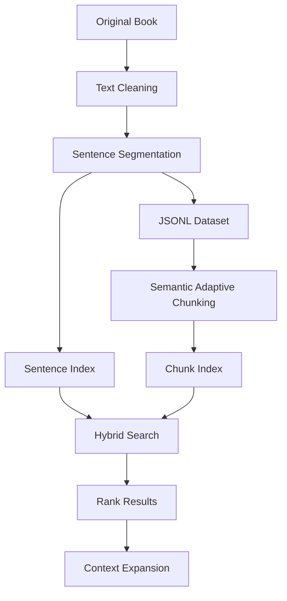

# Siyar Alam al-Nubala (Arabic Retrieval) [IN PROGRESS]

arabic search system for _Siyar Alam Al-Nubala_ (سير أعلام النبلاء), designed to retrieve precise facts and relevant historical context.

## Pipeline

## Approach

1. **Text Cleaning:** remove unwanted formatting, page markers, and extraction artifacts while preserving Arabic content.
2. **Sentence Segmentation:** split biographical entries into individual sentences and store them in JSONL.
3. **Semantic Chunking:** group related sentences using local embedding model `embeddinggemma:300m` and cosine similarity based on semantic context.
4. **Indexing:** build sentence-level and chunk-level indexes for precise and contextual retrieval.
5. **Hybrid Search:** combine BM25 keyword search with vector search, then merge rankings using Reciprocal Rank Fusion algorithm.
6. **Context Expansion:** retrieve neighboring sentences or the full biographical entry when needed.

till now xD